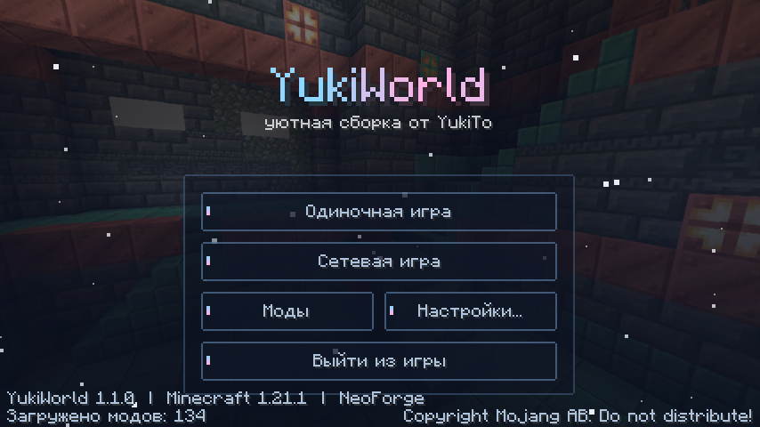

# ❄ YukiWorld

Большая «kitchen-sink» сборка в духе **All The Mods** для **Minecraft 1.21.1 / NeoForge**,
со своим модом **YukiCore**, упором на производительность и собственным интерфейсом.
**111 модов**, **73 квеста FTB Quests** и финал, который объединяет все моды сборки.



## Что внутри

| Категория | Моды |
|---|---|
| ⚡ Оптимизация | Sodium, Lithium, FerriteCore, ModernFix, ImmediatelyFast, Entity Culling, Ksyxis, Fast IP Ping, spark, Iris (шейдеры), Sodium Extra |
| ⚙️ Технологии | Mekanism (+Generators, Tools), Create, Applied Energistics 2 (+AE2WTLib, ExtendedAE), Just Dire Things, Refined Storage, Immersive Engineering, Industrial Foregoing, Actually Additions, Create Crafts & Additions, Create: New Age, Powah, Pipez, Oritech, Silent Gear, Functional Storage, Modular Routers |
| ✨ Магия | Ars Nouveau, Iron's Spells 'n Spellbooks, Occultism, Apotheosis, EvilCraft |
| 📜 Квесты | FTB Quests, FTB XMod Compat, FTB Ultimine |
| 📦 Хранение | Sophisticated Backpacks / Storage, Storage Drawers, Tom's Storage |
| 🌍 Мир | Biomes O' Plenty, Terralith, The Aether, Twilight Forest, YUNG's Better *, When Dungeons Arise, Artifacts, Waystones, The Bumblezone |
| 🌾 Фермы | Farmer's Delight, Productive Bees, Mystical Agriculture |
| 🏠 Декор | Supplementaries, Handcrafted, Chipped, Macaw's |
| 🧭 Удобство | JEI, Jade, Xaero's Minimap + World Map, AppleSkin, Mouse Tweaks, Controlling, Better Advancements и др. |
| ❄ **YukiCore** | свой мод — см. ниже |

Полный список — [`pack/mods.txt`](pack/mods.txt). Зависимости подтягиваются автоматически.
Строки `cf:` берутся с CurseForge (FTB Quests, Twilight Forest, ExtendedAE, Just Dire Things), остальное — с Modrinth.
Botania и MemoryLeakFix под 1.21.1 NeoForge не выходили.

## ⭐ Финал: YukiCore объединяет все моды

YukiCore — последняя ступень сборки. Каждое ядро собирается из топовых предметов своей группы модов
вокруг **Морозного ядра**:

```
Морозное ядро ─┬─ ⚙ Технологическое ядро  ← Mekanism (абсолютная схема), AE2 (сингулярность), Create (точный механизм),
               │                            Powah (нитро-конденсатор), IE, Refined Storage, Oritech, Industrial Foregoing
               ├─ ✨ Магическое ядро        ← Ars Nouveau (дань Вилдена), Iron's Spells, Occultism, Apotheosis, EvilCraft
               ├─ 🌾 Ядро природы           ← Mystical Agriculture (пробуждённый супремиум), Bumblezone, Farmer's Delight,
               │                            Productive Bees, Twilight Forest, Artifacts
               └─ 🌌 Ядро измерений         ← звезда Незера, дыхание дракона, эхо, тяжёлое ядро, Aether, Twilight Forest
                        │
   4 ядра + антиматерия Mekanism + кристаллы времени JDT ──► ❤ Сердце YukiWorld
                        │
   Механический крафтер Create 5×5: сердце + 2 звезды Юки + очищенное сияние + теневая сталь + сингулярности AE2
                        ▼
              ⭐ Бесконечная звезда Юки  — в инвентаре: полёт, ночное зрение, сопротивление, насыщение
              🗡 Клинок Юки               — неразрушимый, урон 30
```

Если какого-то мода нет (например, собираешь свою версию), у каждого ядра есть запасной ванильный рецепт —
игра не сломается (условия `neoforge:mod_loaded`).

## 📜 Квесты (FTB Quests)

6 глав, 73 квеста, на русском и английском (`pack/config/ftbquests/quests`):
**❄ Добро пожаловать → ⚙ Технологии / ✨ Магия / 🌾 Природа / 🌌 Измерения → ⭐ Финал YukiWorld**.
Квесты ведут по каждому моду до компонентов ядер; награды — опыт и предметы.
Квесты генерируются скриптом `tools/gen_quests.py`: правишь список, запускаешь, ID стабильны (прогресс не сбрасывается).

## YukiCore — свой мод

**Контент**
- **Руда кристалла Юки** (обычная и глубинная, слабо светится) → *Кристалл Юки*
- **Морозная руда** → *Необработанный мороз* → *Морозный слиток*
- **Морозные инструменты** (между алмазом и незеритом, энчант 20) — меч замедляет врагов
- **Морозная броня** (3/8/6/3, прочность 2.5)
- **Звезда Юки** — ПКМ: ночное зрение, скорость II, прыгучесть II, регенерация (КД 2 мин)
- **Морозное яблоко** — скорость и огнестойкость
- Блоки: морозный блок, блок кристалла Юки, **Лампа Юки** (свет 15)
- Эндгейм: 5 ядер, Сердце YukiWorld, Бесконечная звезда Юки, Клинок Юки (см. выше)
- Своя вкладка творческого режима, рецепты видны в JEI, теги `c:` для совместимости с техно-модами

**Интерфейс**
- Своё **главное меню**: панорама + ночной градиент, снегопад, переливающийся логотип, «ледяные» кнопки с анимацией
- **Все кнопки, слайдеры и поля ввода в игре** перекрашены в стиль YukiWorld
- Компактный **HUD**: FPS (цветной), координаты, биом, игровой день — прячется при F3/F1
- Экран настроек прямо из списка модов (Моды → YukiCore → Настройки)

**Оптимизация**
- **Smart FPS** — когда окно свёрнуто/не в фокусе, FPS ограничивается до 10: видеокарта и процессор отдыхают
- Сам мод лёгкий: без тиков блоков, без сущностей, HUD без текстур

## Установка (игроку)

1. Скачай `YukiWorld-1.1.1.mrpack` (из GitHub Actions → артефакт **YukiWorld**).
2. Открой в **Prism Launcher** / **Modrinth App** / **ATLauncher**: «Добавить сборку» → выбрать файл.
3. Выдели **8–10 ГБ ОЗУ** и используй **Java 21**. Рекомендуемые JVM-флаги:
   ```
   -XX:+UseG1GC -XX:+UnlockExperimentalVMOptions -XX:G1NewSizePercent=20 -XX:G1ReservePercent=20
   -XX:MaxGCPauseMillis=50 -XX:G1HeapRegionSize=32M -XX:+AlwaysPreTouch
   ```

## Сборка (разработчику)

```bash
# 1. Мод YukiCore
cd yukiworld/yukicore && ./gradlew build        # → build/libs/yukicore-1.1.1.jar
./gradlew runClient                              # запустить игру с модом

# 2. Сборка .mrpack (нужен packwiz: go install github.com/packwiz/packwiz@latest)
bash yukiworld/pack/scripts/build-pack.sh        # → yukiworld/pack/build/YukiWorld-1.1.1.mrpack
```

GitHub Actions (`.github/workflows/yukiworld.yml`) делает оба шага сам при каждом пуше
и выкладывает `.jar`, `.mrpack` и отчёт `mods-report.txt` в артефакты.

Текстуры, модели, рецепты, генерация руд и локализация создаются скриптом
`tools/gen_assets.py` (пиксель-арт задан прямо в коде), квесты — `tools/gen_quests.py`.

## Структура

```
yukiworld/
├── yukicore/            # исходники мода (NeoForge 1.21.1, Java 21)
├── pack/                # packwiz-сборка: pack.toml, mods.txt, config/, scripts/
├── tools/gen_assets.py  # генератор ресурсов мода (текстуры, рецепты, переводы)
└── tools/gen_quests.py  # генератор квестов FTB Quests
```

made by YukiTo ❄
