# ❄🔥 YukiWorld 7.1 — Легенда о Юки: Вечная зима

Большая магическая сборка в духе **All The Mods** для **Minecraft 1.21.1 / NeoForge 21.1.265**: **~180 модов**,
книга квестов на **680 квестов** (44 главы) с подсказками «как получить» к каждому, **дерево магии Юки и Синтары из 44 навыков**, 7 боссов с 3D-моделями
(10 000–30 000 ❤), **сильнейшая броня сборки** с 3D-моделями, расширенный AE2 и космос с ракетами до 7-го уровня.


## 🆕 Что нового в 7.1

### 📜 Понятные квесты
- У **всех 680 квестов** теперь есть описание.
- К каждому предмету в квестах добавлен блок **«Как получить»**. Он собирается из настоящих рецептов модов сборки:
  станок (верстак, миксер Create, высекатель AE2, камера Mekanism, алтарь Юки…) и ингредиенты с русскими названиями.
- Для сложных предметов написаны пошаговые инструкции:
  - **кристаллы времени**: слизь 4-го уровня → почкующийся аметист → зарядка в Верхнем мире, Незере и Энде → рост
    кристаллов;
  - слизь Just Dire Things, ключи данжей Эфира, трофеи боссов, кузня Гефеста и т. д.
- У квестов на боссов есть подсказка **«Где найти»**, у квестов на измерения — **«Как попасть»**.
- Хроматическое соединение, очищенное сияние и теневую сталь Create 6 больше нельзя было получить вообще.
  Им добавлены рецепты: миксер Create и Морозная кузня.

### 🪐 Планеты стали интереснее
- **Три биома на каждой планете:**

  | Планета | Биомы |
  |---|---|
  | Юкия | ледяные равнины с айсбергами, морозный лес, кристальный ледник со шпилями кристаллов Юки |
  | Аврора | аметистовые поля, сияющая долина (мох, азалии, аллаи), шпили сияния |
  | Пиролит | базальтовые дельты, пепельные пустоши, магмовые поля с озёрами лавы |
  | Никта | скалковые равнины, поля пустоты (хорус, шалкеры), теневой лес |
  | Целестия | кварцевые террасы, золотые луга с вишнями, звёздный сад |

- **Постройки:**

  | Планета | Постройки |
  |---|---|
  | Юкия | иглу, разрушенные порталы |
  | Аврора | руины тропы, испытательные залы |
  | Пиролит | бастионы, крепости, окаменелости |
  | Никта | древний город с Хранителем |
  | Целестия | города Края, испытательные залы |

  В сундуках на планетах лежит особый лут: эссенции, кристаллы маны, тома знаний, осколки звезды.
- **Явления раз в 3–6 минут:**
  - метель на Юкии (морозит, но с неба падают кристаллы Юки);
  - северное сияние на Авроре (лечит и даёт ману);
  - метеоритный дождь на Пиролите;
  - пустотный разлом на Никте;
  - звездопад на Целестии.

  Админ-команда для запуска явления: `/yukimagic planetevent`.
- **Небо:** с каждой планеты видны соседние планеты Системы Юки. У Пиролита красное солнце, у Никты почти нет света.
- **Квесты:** в главы планет добавлено 20 квестов исследования.

| Аврора | Целестия | Пиролит | Юкия |
|---|---|---|---|
| 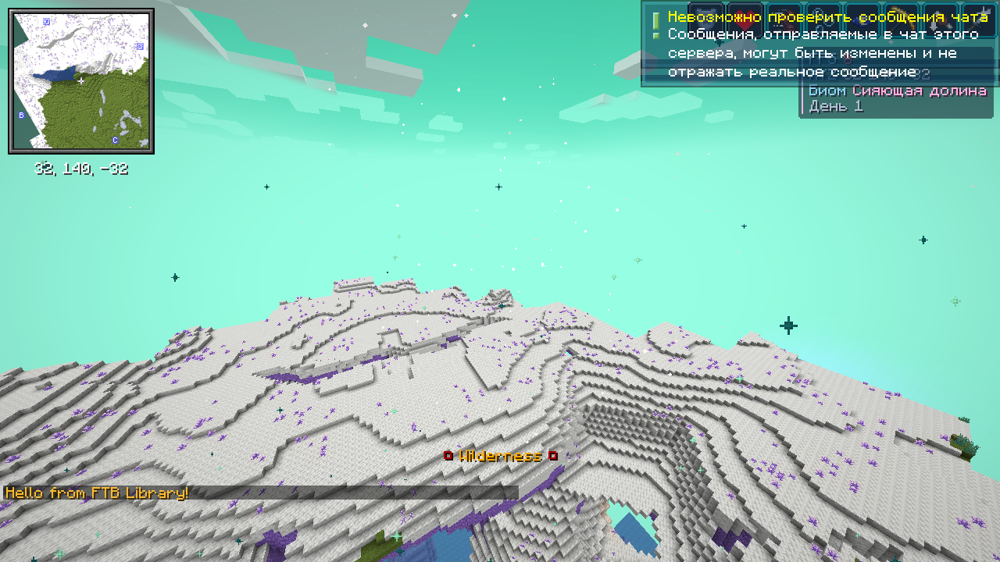 | 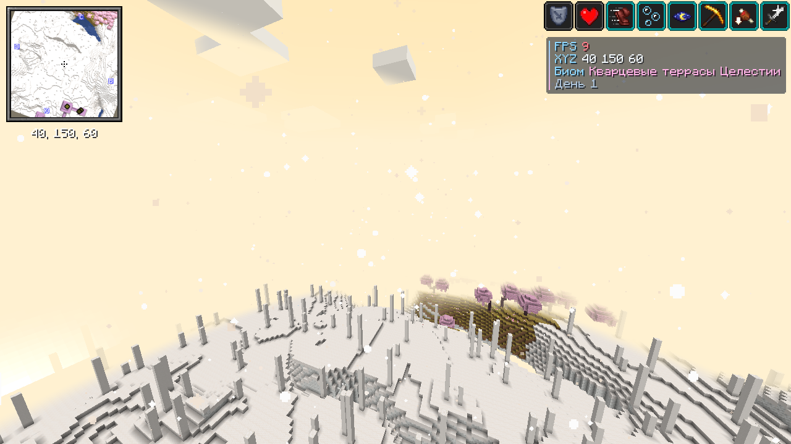 | 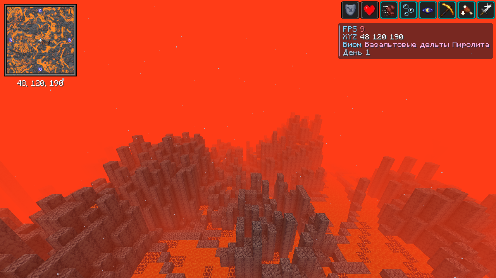 | 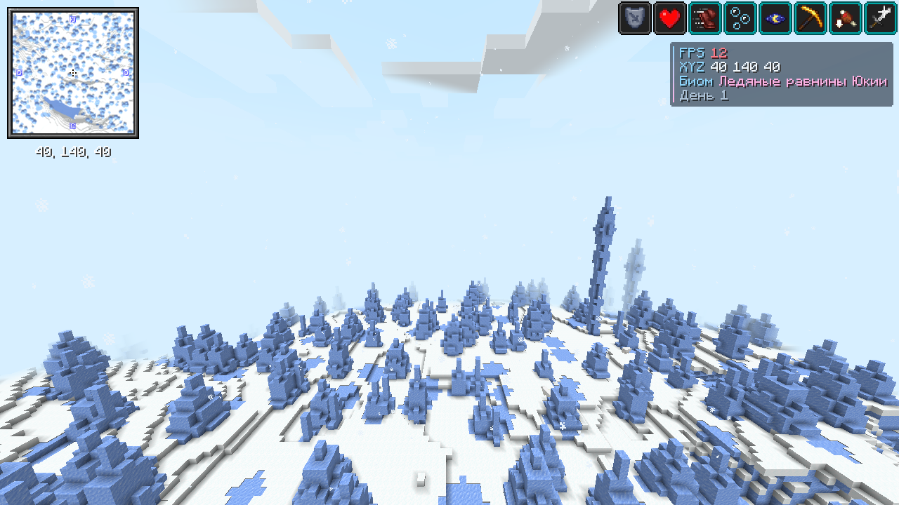 |

## Что было в 7.0

### 🌳 Дерево магии: 22 навыка в каждой ветке
- У Юки и у Синтары по **22 навыка**: 16 заклинаний и 6 пассивных талантов на 9 ступенях.
- Навык открывается **только после всех предков**, поэтому дерево качается по очереди.
- Уровни школ — до **60**. За уровень даётся 1 очко и ещё одно за каждый 5-й, тома зимы/пламени добавляют до +10.
  Всё дерево на максимум не прокачать, путь приходится выбирать.
- Урон в разы выше: ледяная стрела 25, нова 30, удар ледника 180, тюрьма 250, Абсолютный ноль 600, Сверхновая 700,
  солнечный удар 500. Всё это множится на ранг, таланты и снаряжение.
- Магия игнорирует кадры неуязвимости, поэтому многоударные заклинания бьют в полную силу. По боссу одно заклинание
  снимает до 5% здоровья за удар (обычное оружие — 2,5%).
- Масштаб и экшен:
  - ледяные пики, стены, колонны и падающая глыба ледника — настоящие 3D-блоки;
  - лавовые озёра, огненные столпы и солнечный столп в 40 блоков;
  - **тряска камеры**;
  - метеоритный дождь, огненные смерчи, полярная буря;
  - призыв ледяных стражей и огненных духов;
  - **Аватары Юки и Синтары** (50 уровень): полёт, аура, −75% маны.
- 6 **ячеек быстрых заклинаний**: ПКМ по навыку в Гримуаре кладёт его в ячейку, `R` — сотворить,
  `Z` / `Shift+Z` — переключить ячейку.

| Дерево Синтары | Абсолютный ноль | Метеоритный дождь |
|---|---|---|
| 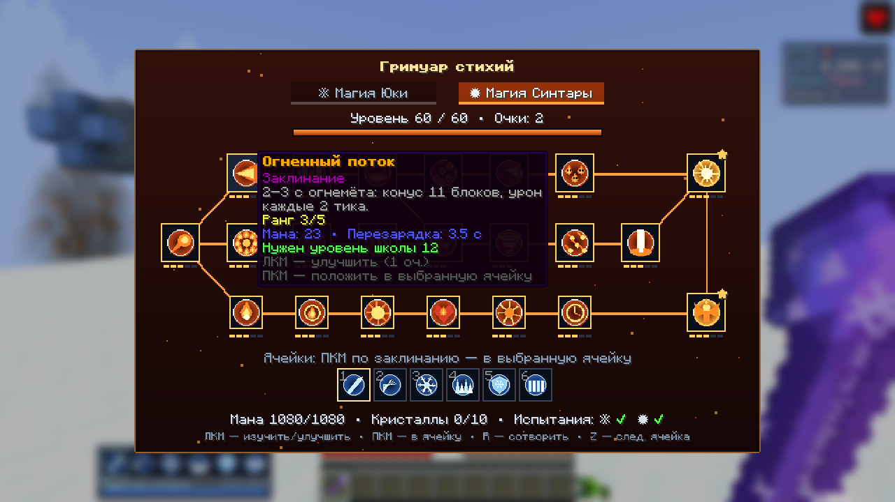 | 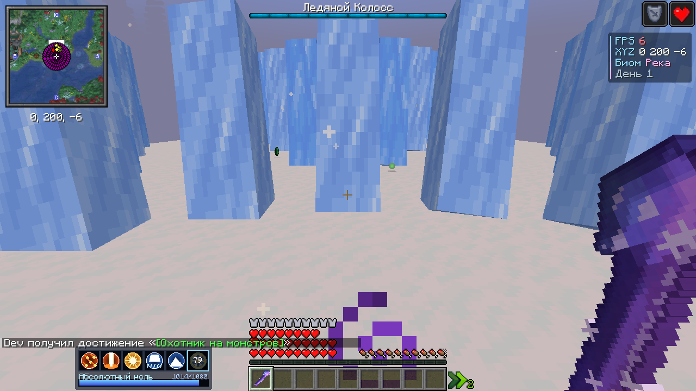 | 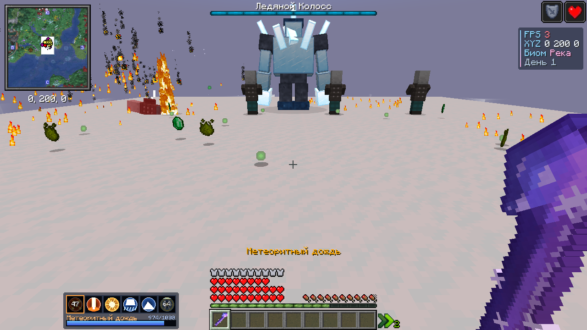 |

### 🛡 Броня YukiCore — сильнейшая в сборке
Каждая часть снижает **любой урон** на свой процент сверх обычной защиты и добавляет здоровье:

| Комплект | Снижение урона | Бонус |
|---|---|---|
| Мороз | 15% | скорость, сила |
| Аврорий | 25% | сила II, регенерация |
| Целестий | 42% | сила III, регенерация II, ночное зрение |
| Регалии Юки / Синтары *(3D)* | 50% | +15% силы школы за часть, −8% маны, +60 маны |
| **Вечная зима** *(3D)* | **75%** | +40 ❤, **полёт**, иммунитет к огню, холоду и иссушению, сила IV |

3D-модели получили мантии криоманта и пироманта, регалии (венцы, ледяные и огненные крылья) и Вечная зима
(рогатый шлем, наплечники, кристаллы на спине). У всех есть светящиеся части.

| Регалии Юки | Вечная зима |
|---|---|
| 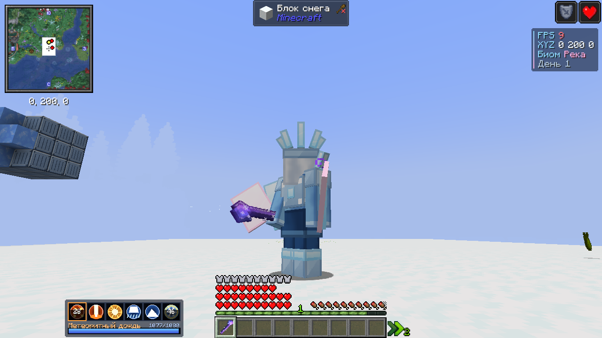 | 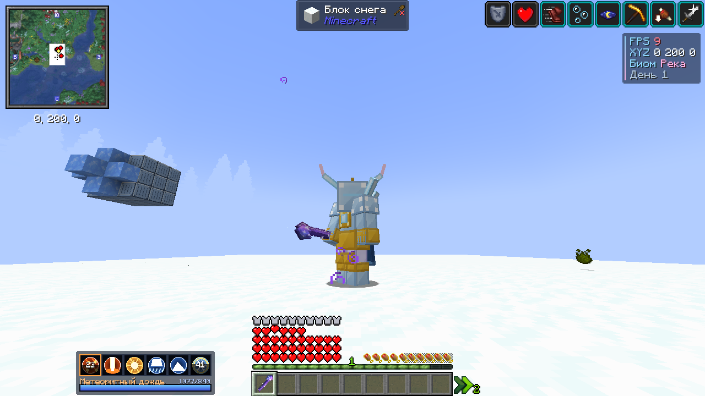 |

### ⚡ Энергия и 💠 AE2
- **Звёздный реактор**: до **10 млн FE/т** (осколок звезды), буфер 2 млрд FE, отдача до 50 млн FE/т на сторону.
- **Морозная кузня** принимает 20 млн FE/т и делает детали AE2: флюикс, все процессоры, сингулярности.
- Новые аддоны AE2: MEGA Cells, Applied Flux, Applied Mekanistics, ME Requester, AE Additions,
  Applied Generators, Ars Énergistique, AE2 Network Analyzer.
- Новая глава квестов «ME-сеть Юки».

### 🚀 Ракеты перед планетами
Квесты и рецепты выстроены так, что ракета строится **до** полёта:
- Морозная ракета (V) → Юкия и Аврора;
- ракета Синтары (VI) → Пиролит;
- Звёздная ракета (VII) → Никта и Целестия.

Рецепты ракет и скафандров берут материалы только с уже пройденных планет.

## Что было в 6.0

### ❄🔥 Магия Юки (лёд) и Синтары (пламя)
Две школы, каждая качается отдельно до **30 уровня**: опыт идёт за заклинания, урон и убийства магией.
За уровни даются **очки навыков** (каждый 5-й уровень — 2 очка).

| ❄ Юки — контроль | ✹ Синтара — разрушение |
|---|---|
| Ледяная стрела (веер с 3 ранга) | Огненный шар (очередь с 3 ранга) |
| Ледяная нова — заморозка вокруг | Огненное кольцо — поджог и отбрасывание |
| Ледяной панцирь — щит, атакующие мёрзнут | Крылья феникса — взлёт, регенерация, +30% огня |
| Ледяной шаг — телепорт | Огненный рывок сквозь врагов |
| Метель в точке | Метеор (на 5 ранге — три) |
| ★ **Абсолютный ноль** — заморозить всё в 12 блоках | ★ **Сверхновая** — взрыв и минута «Возрождения» |

- У каждого заклинания **5 рангов**, у каждой школы ещё **2 таланта** (запас маны, реген, сила).
- Ультимативные заклинания открываются только после **Испытания стихий**: победи
  **Ледяного Архонта** или **Пламенного Феникса** (он один раз возрождается из пепла).
- **Клавиши:** `K` — Гримуар стихий (дерево навыков), `R` — сотворить, `Z` — следующее заклинание.
- Слева от хотбара — мана и выбранное заклинание с перезарядкой.
- Снаряжение: Гримуар Юки и Фолиант Синтары, посохи (+25%), **Посох Двух Стихий** (+40% обеим),
  мантии криоманта/пироманта, 4 кольца, зелья маны, эссенции, кристаллы маны, свиток забвения.
- Стихии важны: лёд бьёт огненных врагов в 1,5 раза сильнее, огонь — ледяных.
- Админ-команда: `/yukimagic xp|trial|mana|reset`.

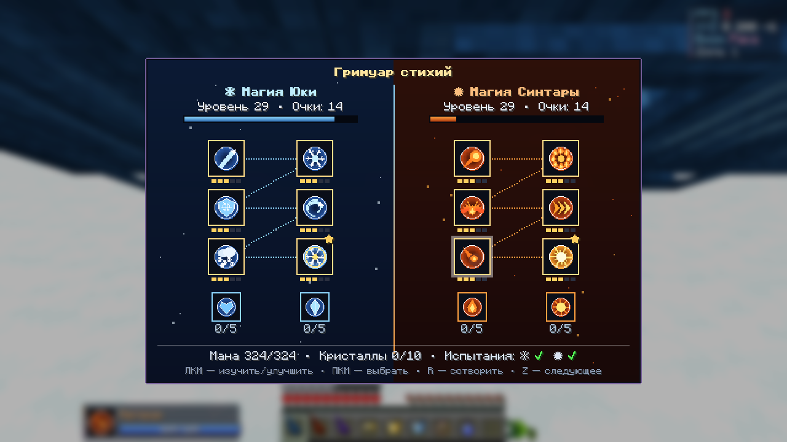

### 🐉 Боссы: 3D-модели, 10 000+ ❤, три фазы
| Босс | ❤ | Атаки |
|---|---|---|
| Ледяной Колосс | 10 000 | удар, сокрушение, ледяные шипы, валуны, землетрясение, лавина, рёв мороза |
| Королева Метелей | 12 500 | веер стрел, нова, телепорт, сосульки, ледяная тюрьма, шторм осколков, метель |
| Повелитель Пепла | 15 000 | рассечение, огненные шары, метеоры, кольцо огня, рывок, извержения, инферно |
| Пустотный Змей | 18 000 | пике, дыхание пустоты, сферы, импульс тьмы, удар хвостом, разлом |
| Тень Юки | 30 000 | дождь клинков, рывок, лёд+пламя, двойники, затмение, коллапс звезды, звёздная волна |
| Ледяной Архонт *(новый)* | 10 000 | рубящий удар, волна льда, удар щитом, копья из-под земли, тюрьма, лавина |
| Пламенный Феникс *(новый)* | 10 000 | пике, перья, огненный смерч, порыв, солнечная вспышка, **возрождение** |

- У каждого своя модель с анимациями ходьбы/полёта и каждой атаки.
- HD-текстура ×4 и **светящийся слой**: лёд, лава, глаза, звёзды.
- **Три фазы**: на 66% и 33% здоровья босс ревёт, отбрасывает игроков и зовёт свиту.
- Круги на земле предупреждают об ударе, через ударные волны можно перепрыгнуть.
- Один удар снимает не больше 2,5% здоровья. Если игроков рядом нет, босс лечится; его нельзя увести с арены.

| 3D-боссы | Бой с Колоссом | Метеор Синтары |
|---|---|---|
| 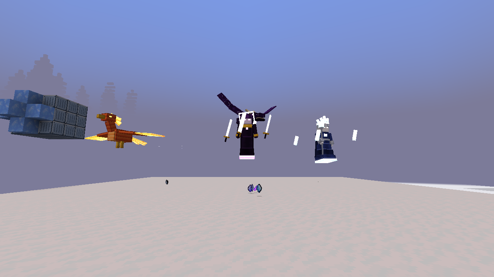 | 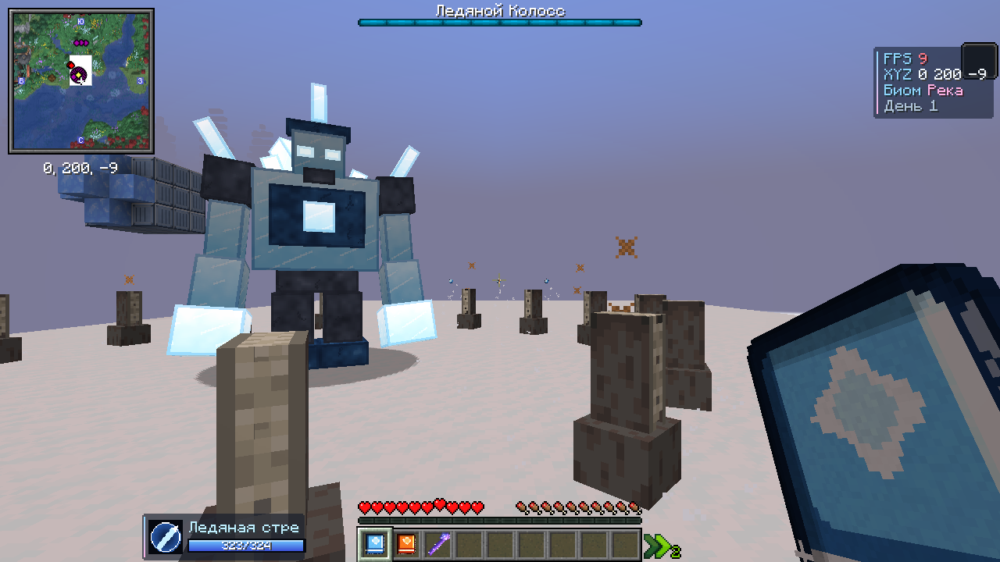 | 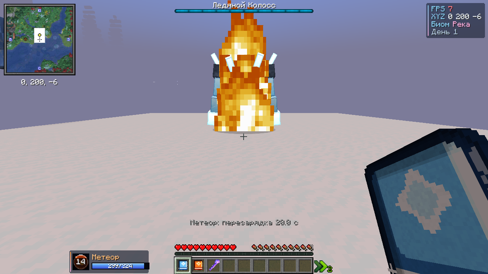 |

### 🚀 Больше ракет и скафандров
- **Морозная ракета** (5 уровень) → Аврора и Пиролит.
- **Ракета Синтары** (6) → Никта.
- **Звёздная ракета Юки** (7) → Целестия.
- Собираются на механическом крафтере Create, в полёте — модели Ad Astra в своих цветах.
- Скафандры: **Морозный** (2 000 мБ, холод), **Синтары** (4 000 мБ, жар и холод),
  **Звёздный** (8 000 мБ; комплект даёт ночное зрение, скорость и снимает урон от падения).

### 🔮 Магические моды
Добавлены: Goety, Malum, Theurgy, Forbidden & Arcanus, Nature's Aura, Mahou Tsukai, Reliquary, Hexerei,
Ars Elemental / Additions / Creo / Ocultas, Iron's Jewelry, Cataclysm Spellbooks, Discerning the Eldritch,
Relics, Enchanting Infuser, Magic Vibe Decorations.

### 📜 Квесты
Семь новых глав: «Две стихии», «Мир магии», «Испытания стихий», три ракетные главы и «Посох Двух Стихий».
Глава Синтары переписана: теперь она **огненная волшебница**. В Летописи появились разделы «Две стихии»
и «Ракеты и скафандры».

> **Для сервера:** боссы и заклинания подбрасывают игроков, поэтому включи `allow-flight=true`
> в `server.properties`, иначе сервер будет кикать «за полёт».

## Что было в 5.0

**🏭 Новые мультиструктуры** (куб 3×3×3, контроллер в центре боковой грани, строится в любую сторону,
схемы в 3D — в Летописи, раздел «Индустрия»):

| Структура | Корпус · ядро · верхние углы | Что делает |
|---|---|---|
| **Морозная кузня** | морозная обшивка · синий лёд · лампы Юки | сплавы за FE (свой тип рецептов, вкладка в JEI): **криосталь**, **звёздный сплав** (4 млн FE), **удвоение всех руд** YukiCore; работает с трубами и кабелями |
| **Звёздный реактор** | обшивка реактора · звёздный свет · целестий | сжигает осколки: от 400 до **10 000 FE/т**, раздаёт энергию во все стороны |

Вместе с Алтарём Юки (3 уровня) — 5 мультиструктур YukiCore.

**⚔ Всё тяжелее.** Боссы планет +50% здоровья (Колосс 900 ❤ … Тень Юки 2400 ❤). Морозное ядро требует
блоки криостали, Сердце и Нестабильная звезда — звёздный сплав, алтарь — криосталь. Механический крафтер
Create даёт 2 вместо 3, антипротонный синтезатор Mekanism требует блок криостали.
Всего 149 рецептов YukiCore и 12 перекрытых рецептов других модов.

**💜 Для друга — Sintara.** Глава квестов «Сияние Синтары»: Синтара — хранительница северного сияния
и подруга Юки. **Посох Синтары** — луч сияния (24 урона всем на 24 блока) и Сияние, которое лечит
и усиливает союзников. **Амулет Синтары** — удача, ночное зрение, подсветка врагов. Лампы сияния и
благодарность в главном меню.

**✨ Красивые квесты.** Баннеры над главами (новогодний, финальный, сияние Синтары), снежинки, звёзды и
ёлочки по краям, путь квестов волной, формы и размеры по типу (сюжет, босс, новый мир, финал главы),
цветные заголовки и подзаголовки.

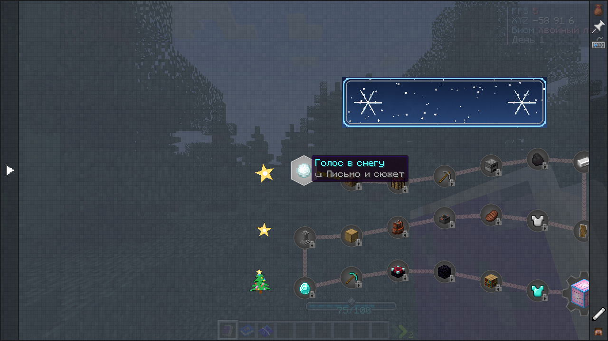

## Что было в 4.0

**🎄 Новый год.** Главное меню с гирляндой и поздравлением, глава квестов «Новогодняя сказка»,
**адвент-календарь** (подарок каждый игровой день, большой подарок каждый 7-й), **подарки** (падают с
зимних бродяг и снежных големов, даются за финал каждой главы), угощения с эффектами — **мандарины** (растут
в еловой листве), **леденцы**, **пряники**, **горячий шоколад**, **оливье** — и светящиеся украшения:
гирлянды, ёлочные игрушки, ёлочки, снежные шары.

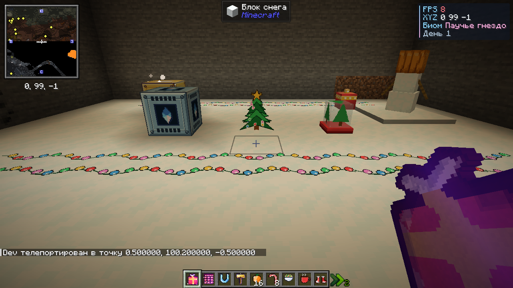

**🧰 Полезные вещи YukiCore** (глава «Мастерская Юки»):

| Предмет | Что делает |
|---|---|
| Морозный / Небесный магнит | притягивает предметы и опыт (радиус 8 / 16), ПКМ — вкл/выкл |
| Ауриевый / Целестиевый молот | копает 3×3, с Shift — один блок |
| Снежные ботинки | ходьба по рыхлому снегу, скорость на льду, ледяной мост по воде |
| **Криогенератор** | энергия от льда вокруг, до **240 FE/т**, сам раздаёт её кабелям и машинам |
| **Часы Юки** | ускоритель времени как в ATM: машины и растения рядом работают **×4** |


**⚙ Крафты как в ATM.** Топовые предметы других модов теперь требуют материалы YukiCore:
абсолютная схема, абсолютный энергокуб, индукционная ячейка и установщик Mekanism; нитро-конденсатор,
нитро-ячейка и нитро-реактор Powah; компонент 256k AE2; калоритовый двигатель Ad Astra; незеритовый
рюкзак. Плюс 17 новых рецептов YukiCore (всего **129** и 24 ритуала алтаря).

**⚡ Оптимизация.** Новые моды: Noisium, ServerCore, Structure Layout Optimizer, More Culling,
BadOptimizations, AI Improvements, Alternate Current, Clumps, Get It Together, FastFurnace,
FastWorkbench, Fast Paintings. В YukiCore — **адаптивная дальность прорисовки**: если FPS падает ниже
цели, дальность уменьшается на чанк, а при запасе возвращается к твоей настройке (настройки YukiCore →
«Производительность»). Плюс прежний Smart FPS в фоне.

## 📖 Сюжет

> Когда-то над всеми мирами шёл тихий снег. Его хранила **Юки** — дух зимы. Эндер-дракон расколол её
> Сердце, но настоящим врагом оказалась **Тень Юки** — проклятие, рождённое из осколков. Тень унесла силу
> Юки к далёкой звезде, в **Систему Юки**, и поселила на пяти планетах стражей.
>
> Ты — **Хранитель**. Освой машины и магию Земли, пройди иные миры и их чудовищ, построй ракету,
> победи стражей планет, собери Сердце, зажги Бесконечную звезду и в последней битве на Целестии
> освободи Юки.

Сюжет рассказывают письма Юки в начале каждой главы квестов и книга **«Летопись Юки»** (Patchouli).

## 📜 Квесты: 505 квестов, 4 акта, строго по очереди

| Акт | Главы |
|---|---|
| **I · Земля** | Пролог · Create · Сталь и пар (IE, Mekanism) · Магия (Ars, Iron's) · Тайное (Occultism, EvilCraft, Apotheosis) · Сад и улей · Цифровой мир (AE2, RS) · Энергия (Powah, реакторы) |
| **II · Иные миры** | Пороги миров · Подземье (Undergarden) · Сумеречные хроники (все боссы TF) · Небесные подземелья (Aether, Deep Aether) · Вечный звёздный свет (Eternal Starlight) · Охота на чудовищ (Mowzie's, BoMD, Aquamirae, Bosses'Rise, Iron's) · Катаклизм (все боссы Cataclysm) · Край света · Ледяная кузня · Алтари Юки |
| **III · Звёздный путь** | Космическая программа · Луна · Марс · Венера и Меркурий · Глацио · ❄ Юкия · 💜 Аврора · 🌋 Пиролит · 🌑 Никта |
| **IV · Сердце зимы** | Четыре Ядра · Сердце и Бесконечная звезда · ☀ Целестия: битва с Тенью Юки и эпилог |

Задачи: «принеси», **«победи босса»** (≈60 боссов из 12 модов) и **«посети мир»** (17 измерений).

## 🚀 Космос и Система Юки

Ad Astra (ракеты I–IV, скафандры, кислород, Луна, Марс, Венера, Меркурий, Глацио) + **пять своих планет**
YukiCore — в меню ракеты, раздел «Система Юки». Юкия — ракета IV, Аврора и Пиролит — V, Никта — VI, Целестия — VII:

| Планета | Мир | Руда → материал | Страж (босс) | Трофей |
|---|---|---|---|---|
| ❄ **Юкия** | лёд, снег, можно дышать | вечная мерзлота | **Ледяной Колосс** · 10 000 ❤ | Сердце Колосса |
| 💜 **Аврора** | аметист и кальцит | аврора | **Королева Метелей** · 12 500 ❤ | Корона Метели |
| 🌋 **Пиролит** | базальт, лава, 280° | пиролит | **Пепельный Владыка** · 15 000 ❤ | Пепельное ядро |
| 🌑 **Никта** | скалк, вечная ночь, −180° | пустота | **Пустотный Змей** · 18 000 ❤ | Чешуя Пустоты |
| ☀ **Целестия** | золотой свет | звёздная руда | **Тень Юки** · 30 000 ❤ | Слеза Юки |

Боссов призывают **Печати**, созданные на Алтаре, и печать работает только на «своей» планете.
У каждого босса полоса здоровья, свои атаки (клыки, удары по земле, огненные новы, снаряды шалкеров,
телепорты, молнии, свита) и **фаза ярости** ниже 50% здоровья.

| Боссы | Ледяной Колосс на Юкии |
|---|---|
|  |  |

## 🏛 Мультиструктура «Алтарь Юки»

Предметы кладутся на алтарь и пьедесталы, ритуал запускается **Морозным жезлом**. Ритуалы видны
в **JEI** (своя категория), схемы уровней — в Летописи в 3D.

| Уровень | Структура | Что открывает |
|---|---|---|
| **I · Морозный** | алтарь + 4 пьедестала + 4 колонны (мороз ×2 + лампа) | эссенция, яблоки, звёздный свет, Печать Колосса |
| **II · Звёздный** | 8 пьедесталов, колонны из целестия и звёздного света | печати стражей, **книги выше максимума** (Острота VII, Эффективность VII, Защита VI…), калорит из пиролита, звезда Незера |
| **III · Бесконечность** | + 4 обелиска в 6 блоках | Печать Тени, **Корона Юки**, **Клинок Вечной Зимы** |

| Ритуал | JEI | Летопись |
|---|---|---|
|  |  | 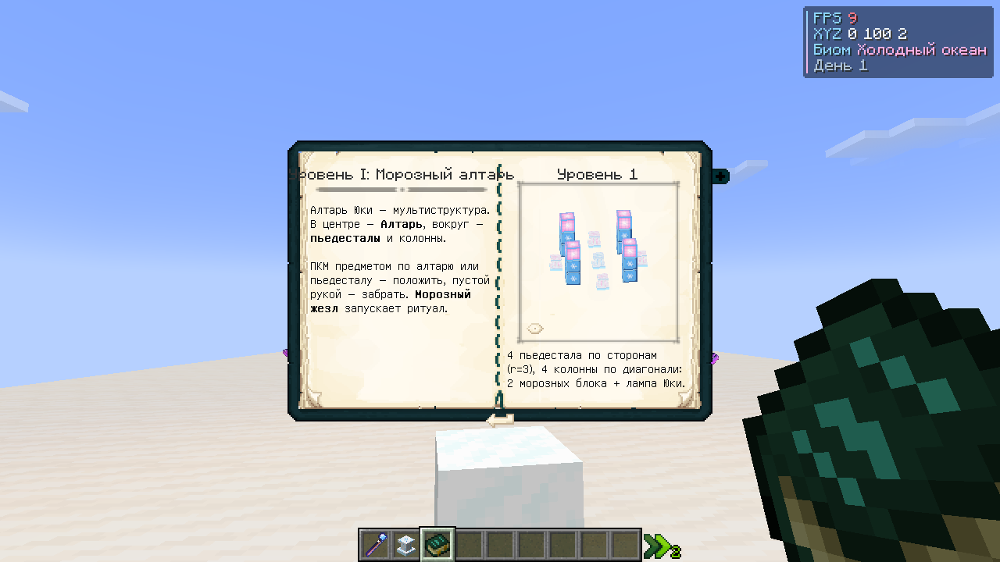 |

Также в сборке мультиблоки других модов, через которые идут квесты: коксовая и доменная печи IE,
SPS и термоядерный реактор Mekanism, нитро-реактор Powah, механические крафтеры Create до 9×9.

## ⭐ Финальная цепочка (112 рецептов YukiCore)

```
Руды Энда → Мороз → (Create: смешивание с перегревом) Ауроний → (Powah: 25 млн FE) Целестий
Морозное ядро (5×5) ─┬─ ⚙ Технологическое · ✨ Магическое · 🌾 Природы · 🌌 Измерений   (7×7, все моды)
Стражи Системы Юки ──┴─ Сердце Колосса · Корона Метели · Пепельное ядро · Чешуя Пустоты
 4 Ядра + 4 трофея + 4 антиматерии + 8 осколков звезды (9×9) ──► ❤ Сердце YukiWorld
 Сердце + сияние/теневая сталь + сингулярности (9×9) → нуклеосинтез Mekanism ──► ⭐ Бесконечная звезда
 Алтарь III: трофеи + звёздный свет ──► Печать Тени ──► ⚔ Тень Юки на Целестии ──► Слеза Юки
 Алтарь III: Слеза + блоки всех планет ──► 👑 Корона Юки (полёт, сопротивление III, все бонусы)
```
Бесконечная звезда — ключ к креативным предметам Mekanism, AE2, Powah, IE и Create (не тратится).

## 🎨 HD-текстуры

Все предметы и блоки YukiCore нарисованы заново в **64×64**: гладкие края, объём, блики, огранённые
кристаллы в рудах, металлические блоки с фаской и снежинкой. Боссы — HD-скины 2–4×.

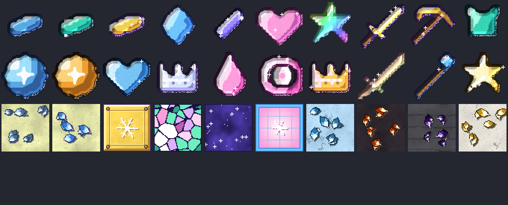

## Установка (игроку)
1. Скачай `YukiWorld-7.1.0.mrpack` (GitHub Actions → артефакт **YukiWorld**).
2. Открой в **Prism Launcher** / **Modrinth App** / **ATLauncher**.
3. Выдели **10–12 ГБ ОЗУ**, **Java 21**.

> Мир из 6.0 можно продолжить: навыки магии сбросятся, очки вернутся (уровни сохранятся, дерево нужно изучить заново).

## Сборка (разработчику)
```bash
python3 yukiworld/tools/gen_assets.py      # HD-текстуры, рецепты, планеты, лут, книга
python3 yukiworld/tools/gen_quests.py ITEMS ENTITIES JARS_DIR   # 680 квестов + подсказки из рецептов модов
cd yukiworld/yukicore && ./gradlew build   # мод (JEI API — maven.blamejared.com, Ad Astra API — Modrinth Maven)
bash yukiworld/pack/scripts/build-pack.sh  # .mrpack (нужен packwiz)
```
`gen_assets.py` использует ванильные текстуры мобов из кэша Gradle и данные Ad Astra (рельеф Глацио) —
пути заданы в начале файла.

```
yukiworld/tools/yukigen/
├── hd.py          # HD-конвейер: апскейл Scale2x, объём, процедурные блоки, скины боссов
├── art.py         # маски предметов и палитры
├── recipes.py     # все рецепты (Create, AE2, Ars, Powah, Mekanism, алтарь)
├── planets.py     # Система Юки для Ad Astra
├── book.py        # Летопись Юки (с 3D-схемами алтаря)
├── models.py      # 3D-модели боссов → Java (BossLayers) + HD-текстуры и свечение
├── v6.py          # 6.0: магия, ракеты, скафандры — текстуры, рецепты, переводы, книга
├── v7.py          # 7.0: дерево из 44 навыков, 3D-броня, AE2 — иконки, тексты, рецепты
├── questbook.py   # главы I–XII
├── questbook3.py  # главы 3.0, акты и порядок
├── questbook4.py  # новогодняя глава и «Мастерская Юки»
└── questbook5.py  # «Индустрия Юки» и глава Синтары
```

made by YukiTo ❄
