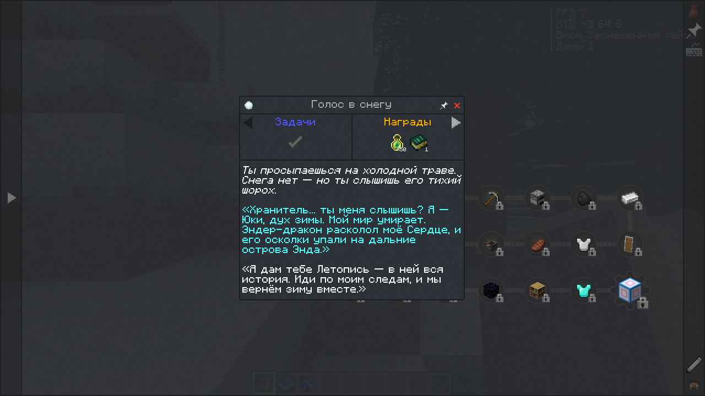
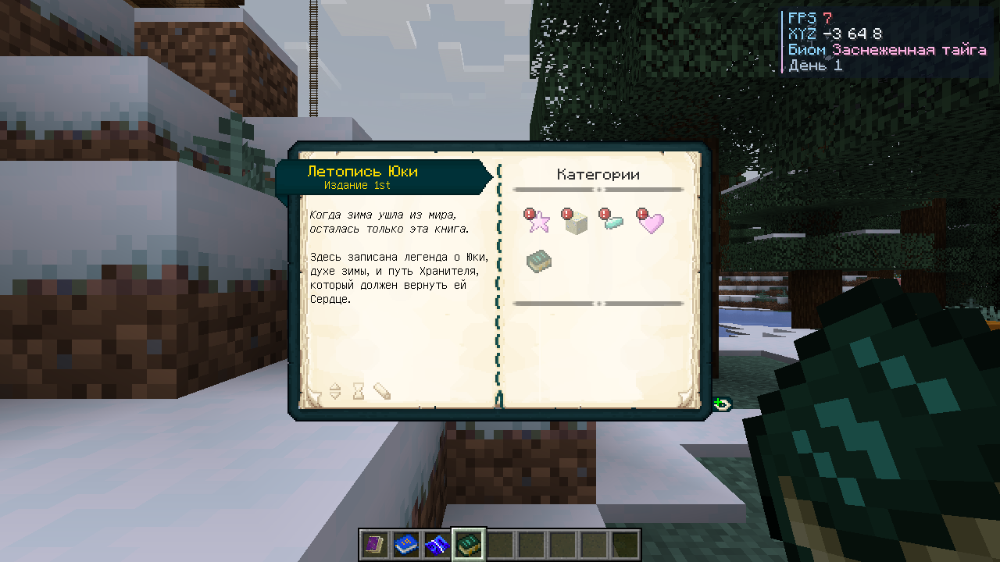
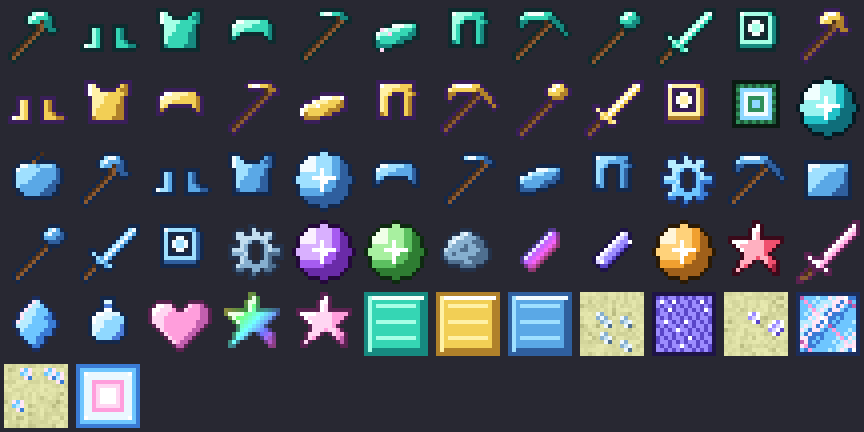
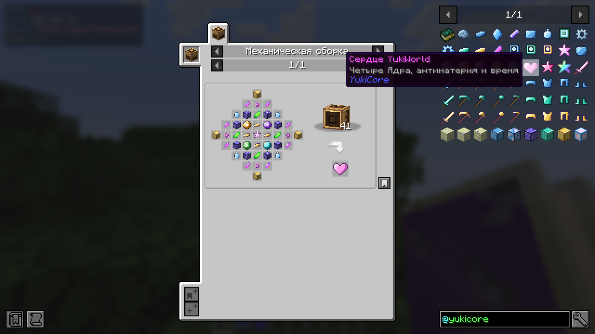

# ❄ YukiWorld 2.0 — Легенда о Юки

Большая «kitchen-sink» сборка в духе **All The Mods** для **Minecraft 1.21.1 / NeoForge 21.1.265**:
**111 модов**, сюжетная книга квестов на **255 квестов**, собственный мод **YukiCore** с тяжёлым
финалом, который объединяет все моды сборки, и свой интерфейс.


## 📖 Сюжет

> Когда-то над всеми мирами шёл тихий снег. Его хранила **Юки** — дух зимы, чьё Сердце держало в
> равновесии машины, магию, природу и границы измерений. Эндер-дракон расколол Сердце, и осколки упали
> на дальние острова Энда. Зима ушла — и мир начал разрушаться.
>
> Ты — **Хранитель**. Освой машины, магию и чужие миры, найди осколки Юки в Энде, выкуй четыре Ядра,
> восстанови Сердце и зажги **Бесконечную звезду**.

Сюжет рассказывают **квесты** (письма Юки в начале каждой главы) и книга **«Летопись Юки»** (Patchouli),
которую игрок получает за первый квест.

| Квесты | Летопись Юки |
|---|---|
|  |  |

## 📜 Квесты: 13 глав, 255 квестов, строго по очереди

Каждый квест открывается только после предыдущего, каждая глава — после прошлой.

| # | Глава | Квестов |
|---|---|---|
| 0 | ❄ Пролог: Пробуждение | 21 |
| I | ⚙ Шестерни (Create) | 20 |
| II | 🔩 Сталь и пар (Immersive Engineering, Mekanism) | 20 |
| III | ✨ Магия пробуждается (Ars Nouveau, Iron's Spells) | 21 |
| IV | 🕯 Тайное знание (Occultism, EvilCraft, Apotheosis) | 16 |
| V | 🌾 Сад и улей (Mystical Agriculture, Productive Bees, Farmer's Delight) | 22 |
| VI | 💾 Цифровой мир (AE2, ExtendedAE, Refined Storage) | 18 |
| VII | ⚡ Энергия (Powah, реакторы Mekanism, Industrial Foregoing, Oritech, JDT) | 21 |
| VIII | 🌌 Пороги миров (Незер, Сумеречный лес, Aether, Бамблзона) | 23 |
| IX | 🐉 Край света (дракон, руды Юки, боссы) | 20 |
| X | 🔨 Ледяная кузня (Мороз → Ауроний → Целестий) | 25 |
| XI | 🔮 Четыре Ядра | 12 |
| XII | ⭐ Финал: Бесконечная звезда + эпилог | 16 |

Задачи — не только «принеси предмет», но и «победи босса» (дракон, Иссушитель, Хранитель, Древний страж)
и «посети измерение».

## ❄ YukiCore 2.0

### Руды — только в Энде
Все руды YukiCore генерируются **только на внешних островах Энда** (после победы над драконом):

| Руда | Встречается | Даёт |
|---|---|---|
| Морозная руда Энда | часто | необработанный мороз → морозный слиток |
| Руда кристалла Юки | средне, светится | кристалл Юки |
| Руда звёздного света | редко, только доменная печь | осколок звёздного света |

**Осколки звезды Юки** (как в ATM) выпадают из боссов: Иссушитель (1–2), Хранитель (1), Древний страж (1).

### Три металла и кузня
Снаряжение улучшается на кузнечном столе шаблонами, как незерит:
**алмаз → ❄ Мороз → 🌈 Ауроний → ✨ Целестий** (9 предметов каждого уровня).
Полный комплект брони даёт бонусы (у Целестия — ночное зрение, огнестойкость, дыхание, регенерация,
сила II, спешка III, скорость II).



### Каждый шаг — машина другого мода
| Компонент | Где делается |
|---|---|
| Морозная пластина | механический пресс **Create** |
| Эссенция Юки | камера наполнения **Ars Nouveau** (3000 источника) |
| Криосхема | высекатель **AE2** |
| Морозный механизм | последовательная сборка **Create** (3 круга) |
| Ауроний | миксер **Create** с перегревом + очищенный обсидиан **Mekanism** + лава |
| Целестий | заряжающий стержень **Powah**, 25 000 000 FE |
| Звезда Юки, Морозное ядро | механический крафтер **Create** 5×5 |
| Четыре Ядра | механический крафтер **Create** 7×7 |
| Сердце YukiWorld, Нестабильная звезда | механический крафтер **Create** 9×9 |
| Бесконечная звезда Юки | антипротонный нуклеосинтезатор **Mekanism**, 1000 мБ антиматерии |



### Финальная цепочка
```
Морозное ядро (5×5) ─┬─ ⚙ Технологическое ← Mekanism, AE2, Create, Powah, IE, RS, Oritech, IF, ExtendedAE, JDT
                     ├─ ✨ Магическое      ← Ars Nouveau, Iron's Spells, Occultism, Apotheosis, EvilCraft
                     ├─ 🌾 Природы         ← Mystical Agriculture, Bumblezone, Productive Bees, FD, TF, Artifacts
                     └─ 🌌 Измерений       ← звёзды Незера, Энд, Древний город, Испытания, Aether, TF
 4 Ядра + 4 антиматерии + 8 осколков звезды + кристаллы времени (9×9) ──► ❤ Сердце YukiWorld
 Сердце + сияние/теневая сталь Create + сингулярности AE2 + полоний (9×9) ──► Нестабильная звезда
 Нуклеосинтез антиматерией (Mekanism) ──► ⭐ Бесконечная звезда Юки
```
* **Бесконечная звезда** в инвентаре: полёт, ночное зрение, сопротивление, насыщение.
* Как ATM Star, она — ключ к **креативным** предметам (куб Mekanism, ячейка AE2, батарея Powah,
  конденсатор IE, мотор Create) и **не тратится** в этих рецептах.
* **Клинок Юки** — неразрушимый, урон 43.

### Интерфейс и оптимизация
* Своё главное меню (снег, переливающийся логотип), все кнопки/слайдеры/поля игры в стиле YukiWorld.
* Компактный HUD (FPS, координаты, биом, день) в правом верхнем углу — не мешает миникарте.
* **Smart FPS**: в фоне FPS ограничивается до 10.
* Меню Cumulus (The Aether) отключено конфигом, чтобы не перекрывать меню YukiWorld.

## Установка (игроку)
1. Скачай `YukiWorld-2.0.0.mrpack` (GitHub Actions → артефакт **YukiWorld**).
2. Открой в **Prism Launcher** / **Modrinth App** / **ATLauncher**.
3. Выдели **8–10 ГБ ОЗУ**, **Java 21**.

> ⚠️ 2.0 — новая версия: руды переехали в Энд, у квестов новые ID. Начинай **новый мир**.

## Сборка (разработчику)
```bash
python3 yukiworld/tools/gen_assets.py      # текстуры, рецепты, руды, лут, книга → yukicore/src/main/resources
python3 yukiworld/tools/gen_quests.py      # 255 квестов → pack/config/ftbquests
cd yukiworld/yukicore && ./gradlew build   # мод
bash yukiworld/pack/scripts/build-pack.sh  # .mrpack (нужен packwiz)
```
GitHub Actions собирает мод и `.mrpack` сам при каждом пуше.

```
yukiworld/
├── yukicore/                 # мод (NeoForge 1.21.1, Java 21)
├── pack/                     # packwiz: pack.toml, mods.txt (cf: — CurseForge), config/
└── tools/
    ├── gen_assets.py         # генератор ресурсов
    ├── gen_quests.py         # генератор квестов
    └── yukigen/              # pixel.py/art.py — текстуры, recipes.py — рецепты, lang.py — названия,
                              # book.py — Летопись Юки, questbook.py — сюжет и все 255 квестов
```

made by YukiTo ❄
